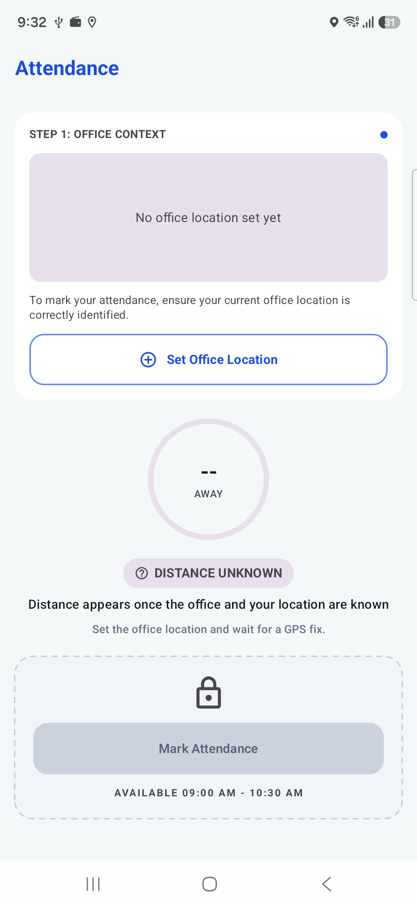
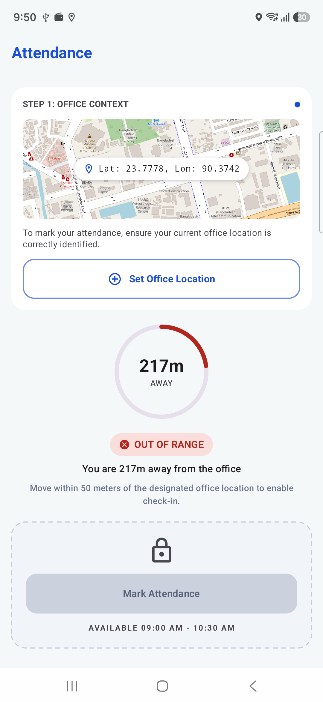
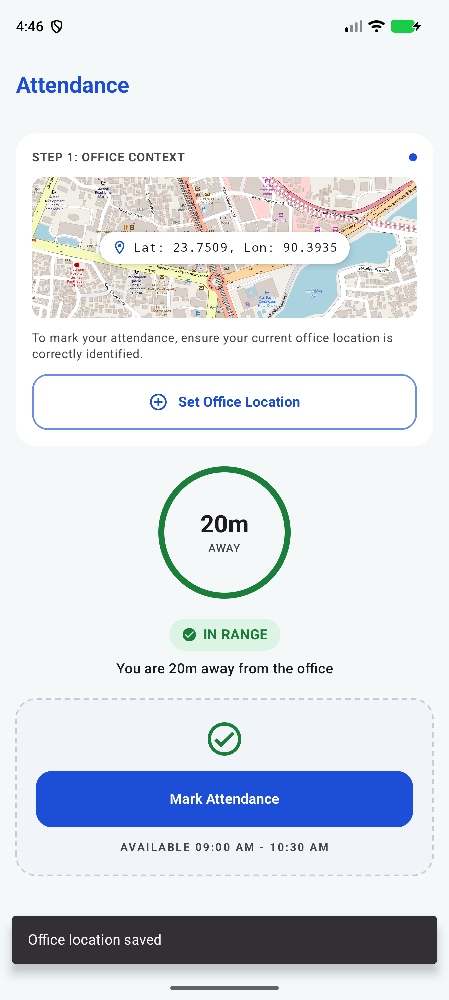
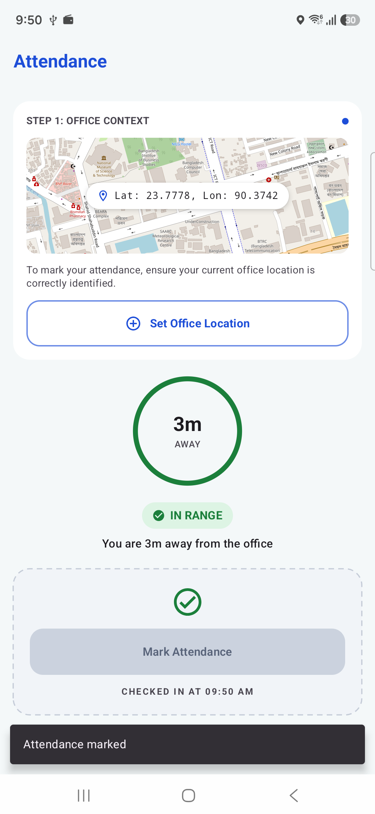
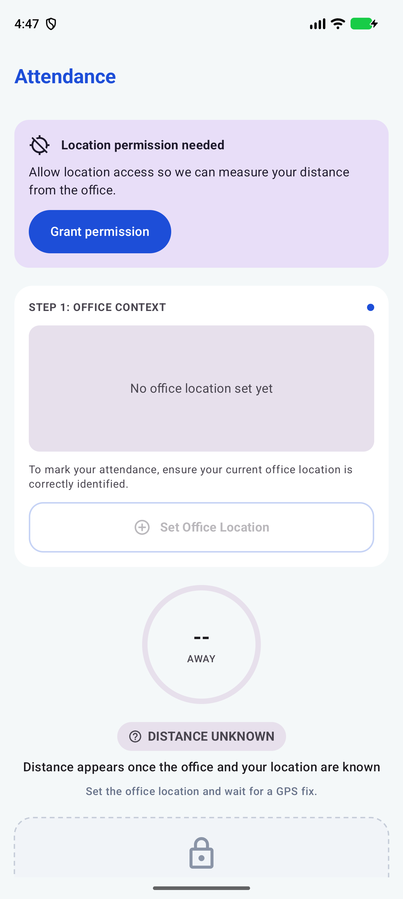
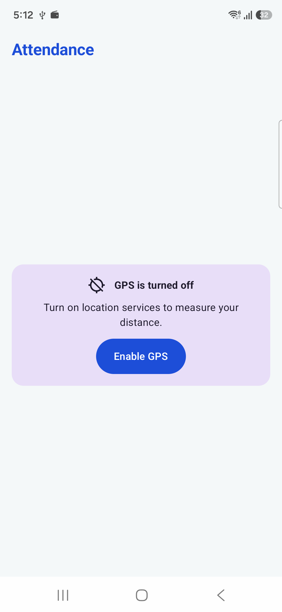

# Pinpoint

**Pinpoint** is a field-ops toolkit: one repo, two apps for people who work away from the desk.

| App | What it does |
|---|---|
| [task-1-android-attendance](task-1-android-attendance) | **Pinpoint Attendance**: a geo-fenced attendance screen. Save the office location once, then check in only when you are within 50 m of it. Native Android, Kotlin, Jetpack Compose. |
| [task-2-flutter-camera-sync](task-2-flutter-camera-sync) | **Pinpoint Capture**: custom camera with zoom and tap-to-focus, plus an offline-first upload queue that retries by itself. Flutter. _In progress._ |

## Project Structure / Approaches

### Task 1: Attendance (Android)
Layered **MVVM**: `ui` -> `domain` -> `data`, dependencies point inward, wired with Hilt constructor injection.
`AttendanceViewModel` combines the location, office and check-in flows (plus a 5 s clock tick) into one
immutable `AttendanceUiState`; the composables only render it.

```
ui/attendance   AttendanceScreen (Android plumbing), AttendanceContent (stateless), components, AttendanceViewModel
domain          AttendanceRules (50 m, 30 m accuracy, 09:00-10:30), use cases, repository interfaces
data            FusedLocationRepository, DataStore office and check-in repositories
```

Patterns, used where they earn their place:
- **Repository**: `LocationRepository`, `OfficeRepository`, `CheckInRepository` are interfaces in domain; the fused
  location and DataStore classes are the implementations.
- **Adapter/Wrapper**: Play Services location and DataStore sit behind those interfaces, so tests use fakes.
- **Use case**: one class per rule: `CalculateDistanceUseCase` (haversine), `EvaluateAttendanceUseCase`,
  `SetOfficeLocationUseCase`, `MarkAttendanceUseCase`.
- **Observer**: Kotlin `Flow`/`StateFlow` end to end.
- **Constructor injection** with Hilt. `java.time.Clock` is injected, so time rules are deterministic in tests.

How the rules work:
- **Set Office Location** takes a fresh GPS fix (accuracy must be 30 m or better) and saves it with DataStore.
  It can be re-set at any time. The office is the phone's position when the button is tapped.
- **Mark Attendance** unlocks only when all of these hold: distance <= 50 m (haversine), accuracy <= 30 m, the fix
  is no older than 15 s, the time is inside 09:00-10:30, and you have not checked in today. It re-checks with a new fix
  at tap time, so a stale reading cannot pass.
- **Live distance** updates about every 2 s ("You are 120m away from the office", plus the ring).
- **Failure states, each with an action:** permission denied (Grant permission), permanently denied (Open settings),
  GPS off (Enable GPS), waiting for a fix (progress), signal lost (warning and locked).

### Task 2: Camera and Sync (Flutter)
_In progress._ Plan: layered architecture with Cubit, a `workmanager` worker with a connectivity constraint and
backoff, a local database for the pending queue, and `MockUploadApi` with a success/failure toggle.

## Assumptions
1. The 09:00-10:30 attendance window is enforced; it is defined as constants in `AttendanceRules`.
   **To test outside those hours, change the device time to a time inside the window** (turn off automatic time).
2. The office location can be re-set at any time, and it is always the current GPS position.
3. One check-in is allowed per day; it is persisted locally.
4. **Mock locations are accepted by default**, so the 50 m rule can be tested with a fake-GPS app. Set
   `AttendanceRules.BLOCK_MOCK_LOCATIONS = true` to reject fixes the platform flags as mock.
5. The mockup's back arrow is left out: this is the app's only screen.
6. The 0.5x camera button appears only on devices with an ultrawide lens (Task 2).
7. No real API was provided, so uploads go through `MockUploadApi` (Task 2).

## Testing
- **37 unit tests** (JUnit, coroutines-test, Turbine): distance and 49/50/51 m range, accuracy and time-window
  boundaries, stale fixes, mock policy, check-in once per day, ViewModel state transitions, DataStore round trips.
- **12 Compose UI tests** (Robolectric, run with the unit tests): locked vs unlocked card, distance text, chip,
  permission, GPS-off and searching banners, checked-in state.
- **1 end-to-end test** on an emulator (Hilt, fake GPS and clock): set office -> move away -> move within 50 m ->
  mark attendance.

```bash
cd task-1-android-attendance
./gradlew lintDebug testDebugUnitTest
./gradlew connectedDebugAndroidTest   # needs an emulator or device
```

## Generative AI Usage
I used **Claude Code** as a pair programmer. I set the architecture rules (`CLAUDE.md`), picked the decisions it
asked about (Hilt, osmdroid, persisted check-in), reviewed every diff, and verified behaviour on a phone and an
emulator. It wrote most of the boilerplate, tests and the Compose UI; I steered the UI against the mockup and fixed
the product decisions. Essential prompts (full list in [PROMPTS.md](PROMPTS.md)):

1. `plan task 1 android attendance screen`: produced the architecture, rules, test plan and commit sequence.
2. `continue with the UI`: built the Compose screen to match the mockup.
3. `Please read the requirements again and check current implementation are on it?`: audit that found a stale
   distance and a resume flicker, both fixed with tests.
4. `go ahead with the end-to-end test`: the Hilt instrumented flow test with fake GPS and a fixed clock.
5. `now analysis the requirement pdf and compare current implementation, did u miss anything?`: gap analysis that
   surfaced the mock-location risk and the unsigned release build.
6. `follow this image style` (with mockup crops): restyled the locked card, button and helper text.

## How to Run

### Task 1: Attendance (Android)
```bash
git clone <repo-url>
cd <repo>/task-1-android-attendance
./gradlew installDebug
```
Requires JDK 17 and Android Studio (or the Android SDK with `ANDROID_HOME` set), plus a device or emulator with
location services. Open the app, allow location, tap **Set Office Location**, then move.
On an emulator, set the position with `adb emu geo fix <longitude> <latitude>`.

Release build (signed with your `key.properties` if present, otherwise with the local debug key):
```bash
./gradlew assembleRelease   # app/build/outputs/apk/release/app-release.apk
```

### Task 2: Camera and Sync (Flutter)
```bash
cd <repo>/task-2-flutter-camera-sync
flutter pub get
flutter run
```
_In progress._ Test on a physical device for camera zoom and background sync.

## Screenshots (Task 1)[PROMPTS.raw.md](PROMPTS.raw.md)

| Setup | Out of range | In range | Checked in |
|---|---|---|---|
|  |  |  |  |

| Permission denied | GPS off |
|---|---|
|  |  |

## Release APK
- **Task 1:** [pinpoint-attendance-v1.0.apk](task-1-android-attendance/assets/pinpoint-attendance-v1.0.apk)
  (use the **Download raw file** button on GitHub).
- **Task 2:** _pending._
