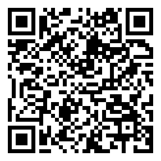
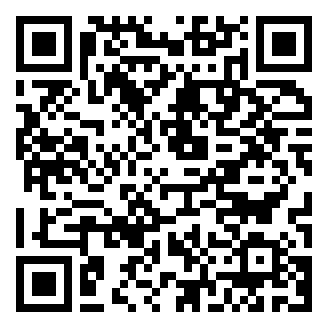

# Pinpoint

**Pinpoint** is a field-ops toolkit: one repo, two apps for people who work away from the desk.

| App | What it does | Download APK |
|---|---|---|
| [task-1-android-attendance](task-1-android-attendance) | **Pinpoint Attendance**: a geo-fenced attendance screen. Save the office location once, then check in only when you are within 50 m of it, inside the 09:00-10:30 window. Native Android, Kotlin, Jetpack Compose. | <br>[Download (Drive)](https://drive.google.com/file/d/1odpxz_C7m0rMTropXR2IPanMAlgQFR43/view?usp=sharing) |
| [task-2-flutter-camera-sync](task-2-flutter-camera-sync) | **Pinpoint Capture**: custom camera with zoom and tap-to-focus, plus an offline-first upload queue that retries by itself. Flutter, Cubit. | <br>[Download (Drive)](https://drive.google.com/file/d/10Rf3YA8qhNenndd1YwCzQpD4J0WHV1qo/view?usp=sharing) |

## Contents
1. [Project Structure](#project-structure)
2. [Generative AI Usage](#generative-ai-usage)
3. [How to Run](#how-to-run)
4. [Screenshots](#screenshots)
5. [Download APK](#download-apk)

Each app has its own README with requirements coverage, tech stack, folder layout, tests and a reviewer guide:
[Task 1: Attendance](task-1-android-attendance/README.md) and
[Task 2: Camera and Sync](task-2-flutter-camera-sync/README.md).

## Project Structure
```
.
├── README.md
├── Demo/                           screen recordings (GIF) for both tasks
├── download-apk/                   release APKs and Drive QR codes
├── task-1-android-attendance/      Task 1: native Android
└── task-2-flutter-camera-sync/     Task 2: Flutter
```

- **Task 1** is layered MVVM (`ui` -> `domain` -> `data`) with Hilt constructor injection. `AttendanceViewModel`
  combines the location, office and check-in flows into one immutable `AttendanceUiState`; the composables only
  render it. 
- **Task 2** is layered `presentation` -> `domain` -> `data` with Cubits (`CameraCubit`, `UploadQueueCubit`,
  `MockModeCubit`). Plugins sit behind domain interfaces, wired by constructor injection in `app/di.dart`.
  
## Generative AI Usage
I used **Claude Code** (Claude model) as a pair programmer on both tasks.

**How I worked with Claude:** I wrote the rules (`CLAUDE.md`), asked for a plan first, then built feature by feature
in small commits. I made the product decisions, tested every build on a real phone, and sent Claude the bugs I found.
I reviewed every diff.

| Task | How Claude was used | Essential prompt |
|---|---|---|
| Task 1: Attendance | Planned the architecture, built the Compose UI, ran a gap analysis against the brief | `plan task 1 android attendance screen` |
| Task 2: Camera and Sync | Planned layers and the sync engine, built the mock API, wrote and ran tests on a device | `plan Task 2: Camera and Sync (Flutter)` |


## How to Run

### Task 1: Attendance (Android)
```bash
git clone https://github.com/samadtalukder/pinpoint-attendance-task.git
cd pinpoint-attendance-task/task-1-android-attendance
./gradlew installDebug
```
Requires JDK 17 and Android Studio (or the Android SDK with `ANDROID_HOME` set), plus a device or emulator with
location services. Open the app, allow location, tap **Set Office Location**, then move.
On an emulator, set the position with `adb emu geo fix <longitude> <latitude>`.

Release build (signed with your `key.properties` if present, otherwise with the local debug key):
```bash
./gradlew assembleRelease   # app/build/outputs/apk/release/app-release.apk
```

### Task 2: Camera and Sync (Flutter)
```bash
cd pinpoint-attendance-task/task-2-flutter-camera-sync
flutter pub get
flutter run
```
Requires Flutter 3.x (Dart `^3.13`). Use a **physical device** for camera zoom, tap-to-focus and background sync.
To see a retry: open the Upload Manager (upload icon, top bar) -> menu -> **Mock upload result** -> Failure, capture
a batch, then switch to Success. The queue uploads by itself, or tap **Retry now**.

Release build:
```bash
flutter build apk --release   # build/app/outputs/flutter-apk/app-release.apk
```

More run steps and a trigger-each-state guide are in the task READMEs.

## Screenshots

### Task 1: Attendance
| Setup | Out of range | In range | Checked in |
|---|---|---|---|
|  |  |  |  |

| Permission denied | GPS off |
|---|---|
|  |  |

Demo (set office, move out of range, move within 50 m, mark attendance):


### Task 2: Camera and Sync
| Camera preview | Batch ready | Upload failed, retrying | Synced |
|---|---|---|---|
|  |  |  |  |


## Download APK
Scan a QR code on your phone, or use the Google Drive link.

| Pinpoint Attendance (Task 1) | Pinpoint Capture (Task 2) |
|---|---|
|  |  |
| [Google Drive](https://drive.google.com/file/d/1odpxz_C7m0rMTropXR2IPanMAlgQFR43/view?usp=sharing) | [Google Drive](https://drive.google.com/file/d/10Rf3YA8qhNenndd1YwCzQpD4J0WHV1qo/view?usp=sharing) |
