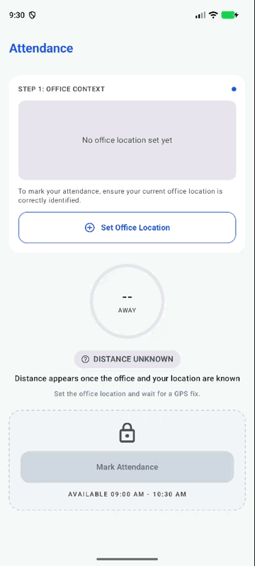

# Pinpoint

**Pinpoint** is a field-ops toolkit: one repo, two apps for people who work away from the desk.

| App | What it does |
|---|---|
| [task-1-android-attendance](task-1-android-attendance) | **Pinpoint Attendance**: a geo-fenced attendance screen. Save the office location once, then check in only when you are within 50 m of it. Native Android, Kotlin, Jetpack Compose. |
| [task-2-flutter-camera-sync](task-2-flutter-camera-sync) | **Pinpoint Capture**: custom camera with zoom and tap-to-focus, plus an offline-first upload queue that retries by itself. Flutter. |

## Project Structure

### Task 1: Attendance (Android)
Layered **MVVM**: `ui` -> `domain` -> `data`, dependencies point inward, wired with Hilt constructor injection.
`AttendanceViewModel` combines the location, office and check-in flows (plus a 5 s clock tick) into one
immutable `AttendanceUiState`; the composables only render it.

```
ui/attendance   AttendanceScreen (Android plumbing), AttendanceContent (stateless), components, AttendanceViewModel
domain          AttendanceRules (50 m, 30 m accuracy, 09:00-10:30), use cases, repository interfaces
data            FusedLocationRepository, DataStore office and check-in repositories
```

Patterns, used where they earn their place:
- **Repository**: `LocationRepository`, `OfficeRepository`, `CheckInRepository` are interfaces in domain; the fused
  location and DataStore classes are the implementations.
- **Adapter/Wrapper**: Play Services location and DataStore sit behind those interfaces, so tests use fakes.
- **Use case**: one class per rule: `CalculateDistanceUseCase` (haversine), `EvaluateAttendanceUseCase`,
  `SetOfficeLocationUseCase`, `MarkAttendanceUseCase`.
- **Observer**: Kotlin `Flow`/`StateFlow` end to end.
- **Constructor injection** with Hilt. `java.time.Clock` is injected, so time rules are deterministic in tests.

How the rules work:
- **Set Office Location** takes a fresh GPS fix (accuracy must be 30 m or better) and saves it with DataStore.
  It can be re-set at any time. The office is the phone's position when the button is tapped.
- **Mark Attendance** unlocks only when all of these hold: distance <= 50 m (haversine), accuracy <= 30 m, the fix
  is no older than 15 s, the time is inside 09:00-10:30, and you have not checked in today. It re-checks with a new fix
  at tap time, so a stale reading cannot pass.
- **Live distance** updates about every 2 s ("You are 120m away from the office", plus the ring).
- **Failure states, each with an action:** permission denied (Grant permission), permanently denied (Open settings),
  GPS off (Enable GPS), waiting for a fix (progress), signal lost (warning and locked).

### Task 2: Camera and Sync (Flutter)
Layered `presentation` -> `domain` -> `data` with **Cubit** (flutter_bloc). Plugins sit behind interfaces defined in
domain, and everything is wired by constructor injection in `app/di.dart`. Each Cubit emits one immutable state
object and the widgets only render it.

```
presentation/camera          CameraPreviewScreen, CameraCubit, zoom slider/presets, focus indicator
presentation/upload_manager  UploadManagerScreen, UploadQueueCubit
presentation/settings        MockModeCubit (mock upload result sheet)
domain                       entities, service interfaces, use cases
data                         sqflite queue, camera plugin, connectivity_plus, workmanager, MockUploadApi
workers                      sync_worker.dart: workmanager entry point
```

Main classes:
- `CameraCubit`: permission, camera start/stop, pinch/slider/preset zoom, tap-to-focus, capture and batch enqueue.
- `UploadQueueCubit`: pending list, progress, pause/resume, retry now, clear synced.
- `MockModeCubit`: success / failure / slow toggle for the mock API.

Patterns, used where they earn their place:
- **Repository**: `UploadQueueRepository` interface in domain, `SqfliteUploadQueueRepository` in data.
- **Adapter/Wrapper**: `camera`, `connectivity_plus`, `permission_handler`, `workmanager` and file storage sit behind
  `CameraService`, `ConnectivityService`, `CameraPermissionService`, `SyncScheduler` and `ImageStore`, so tests use fakes.
- **Use case**: `EnqueueBatchUseCase`, `ProcessUploadQueueUseCase`, `SyncCoordinator`.
- **Observer**: Cubit streams for UI state; a queue-change bus tells the open screen what the background worker did.
- **Strategy**: `UploadApi` has `MockUploadApi` today; a real API is a new implementation, with no consumer changes.

How the sync engine works:
- Captured images are copied to app storage and queued in sqflite (`waiting`, `uploading`, `retrying`, `synced`).
  The queue survives app restarts and process death.
- A `workmanager` one-off task runs only with a network connection and uses exponential backoff
  (10 s start). The worker uploads oldest first and stops at the first failure.
- An upload that fails or takes longer than 15 s (low bandwidth) stays in the queue as `retrying`, with the reason.
- `SyncCoordinator` schedules a run when the app starts with queued images and when connectivity returns, so
  retries need no user action. **Retry now** and **Pause all** exist for manual control.
- No real API was provided. `MockUploadApi` returns hard-coded success or failure. Change it at runtime from the
  Upload Manager menu (**Mock upload result**: Success, Failure, Slow).

## Assumptions
1. The 09:00-10:30 attendance window is enforced; it is defined as constants in `AttendanceRules`.
   **To test outside those hours, change the device time to a time inside the window** (turn off automatic time).
2. The office location can be re-set at any time, and it is always the current GPS position.
3. One check-in is allowed per day; it is persisted locally.
4. **Mock locations are accepted by default**, so the 50 m rule can be tested with a fake-GPS app. Set
   `AttendanceRules.BLOCK_MOCK_LOCATIONS = true` to reject fixes the platform flags as mock.
5. The mockup's back arrow is left out: this is the app's only screen.
6. The 0.5x camera button appears only on devices with an ultrawide lens (Task 2).
7. No real API was provided, so uploads go through `MockUploadApi` (Task 2).
8. "Low bandwidth" is modelled as an upload that exceeds a 15 s timeout (Task 2).
9. The Task 2 release APK is signed with the local debug key unless `android/key.properties` exists.

## Testing
- **37 unit tests** (JUnit, coroutines-test, Turbine): distance and 49/50/51 m range, accuracy and time-window
  boundaries, stale fixes, mock policy, check-in once per day, ViewModel state transitions, DataStore round trips.
- **12 Compose UI tests** (Robolectric, run with the unit tests): locked vs unlocked card, distance text, chip,
  permission, GPS-off and searching banners, checked-in state.
- **1 end-to-end test** on an emulator (Hilt, fake GPS and clock): set office -> move away -> move within 50 m ->
  mark attendance.

```bash
cd task-1-android-attendance
./gradlew lintDebug testDebugUnitTest
./gradlew connectedDebugAndroidTest   # needs an emulator or device
```

### Task 2
- **126 unit and widget tests** (`flutter_test`, `bloc_test`, `mocktail`, `sqflite_common_ffi`): zoom capability and
  ultrawide detection, `CameraCubit` transitions and permission states, queue repository, retry and timeout rules,
  sync scheduling, Upload Manager list states, mock mode sheet.
- **1 integration test** on a device with fakes: capture batch -> upload fails -> queue persists -> upload succeeds.

```bash
cd task-2-flutter-camera-sync
flutter analyze
flutter test
flutter test integration_test   # needs an emulator or device
```

## Generative AI Usage
I used **Claude Code** as a pair programmer. I set the architecture rules (`CLAUDE.md`), picked the decisions it
asked about (Hilt, osmdroid, persisted check-in), reviewed every diff, and verified behaviour on a phone and an
emulator. It wrote most of the boilerplate, tests and the Compose UI; I steered the UI against the mockup and fixed
the product decisions. Essential prompts (full list in [PROMPTS.md](PROMPTS.md)):

**Task 1**
1. `plan task 1 android attendance screen`: produced the architecture, rules, test plan and commit sequence.
2. `continue with the UI`: built the Compose screen to match the mockup.
3. `now analysis the requirement pdf and compare current implementation, did u miss anything?`: gap analysis that
   surfaced the mock-location risk and the unsigned release build.
4. `follow this image style` (with mockup crops): restyled the locked card, button and helper text.

**Task 2**
1. `plan Task 2: Camera and Sync (Flutter)`: layered architecture, Cubits, sqflite queue, workmanager plan.
2. `you will use mock api response data`: `MockUploadApi` with a success / failure / slow toggle.
3. `i have connected my real device, running the app, you will test end to end and cover all the business logic`:
   unit, widget and integration tests, checked on a real phone.
4. `the camera zoom button only showing 1x, 2x but it doesn't match with reference image`: ultrawide lens
   detection so 0.5x shows only when the device has one.
5. `once all synced images in upload manager screen showing 'Pause All' fix it`: hid Pause all when nothing is pending.

## How to Run

### Task 1: Attendance (Android)
```bash
git clone https://github.com/samadtalukder/pinpoint-attendance-task.git
cd pinpoint-attendance-task/task-1-android-attendance
./gradlew installDebug
```
Requires JDK 17 and Android Studio (or the Android SDK with `ANDROID_HOME` set), plus a device or emulator with
location services. Open the app, allow location, tap **Set Office Location**, then move.
On an emulator, set the position with `adb emu geo fix <longitude> <latitude>`.

Release build (signed with your `key.properties` if present, otherwise with the local debug key):
```bash
./gradlew assembleRelease   # app/build/outputs/apk/release/app-release.apk
```

### Task 2: Camera and Sync (Flutter)
```bash
cd pinpoint-attendance-task/task-2-flutter-camera-sync
flutter pub get
flutter run
```
Requires Flutter 3.x (Dart `^3.13`). Use a **physical device** for camera zoom, tap-to-focus and background sync.
To see a retry: open the Upload Manager (upload icon, top bar) -> menu -> **Mock upload result** -> Failure, capture
a batch, then switch to Success. The queue uploads by itself, or tap **Retry now**.

Release build:
```bash
flutter build apk --release   # build/app/outputs/flutter-apk/app-release.apk
```

## Screenshots

### Task 1: Attendance

| Setup | Out of range | In range | Checked in |
|---|---|---|---|
|  |  |  |  |

| Permission denied | GPS off |
|---|---|
|  |  |

Demo (set office, move out of range, move within 50 m, mark attendance):



### Task 2: Camera and Sync

| Camera preview | Batch ready | Upload failed, retrying | Synced |
|---|---|---|---|
|  |  |  |  |


## Release APK
Both release APKs are in [release-apk](release-apk) (use the **Download raw file** button on GitHub).
- **Task 1:** [pinpoint-attendance-v1.0.apk](release-apk/pinpoint-attendance-v1.0.apk)
- **Task 2:** [pinpoint-capture-v1.0.apk](release-apk/pinpoint-capture-v1.0.apk) (arm and arm64 devices; built with
  `flutter build apk --release --target-platform android-arm,android-arm64`)
