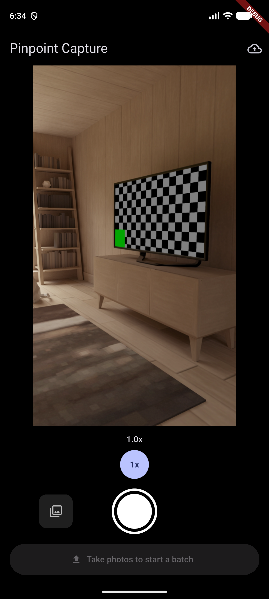
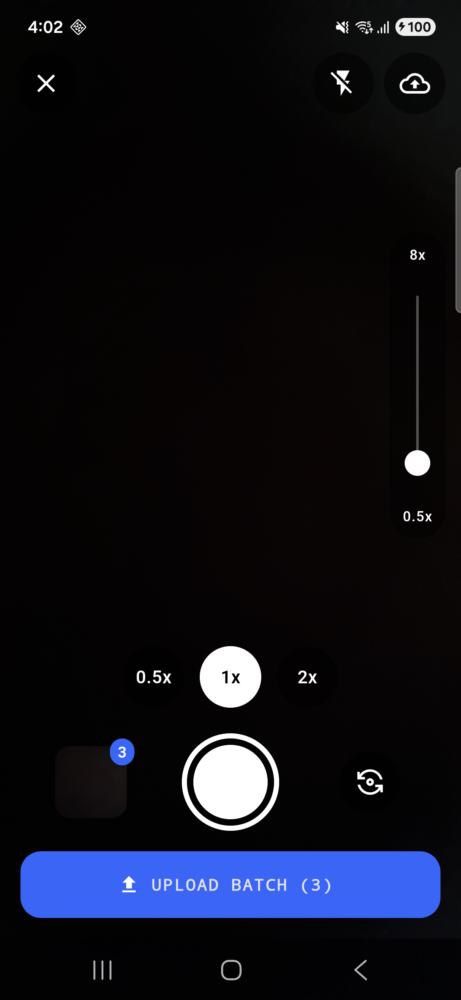
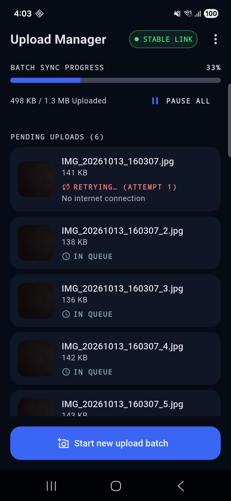
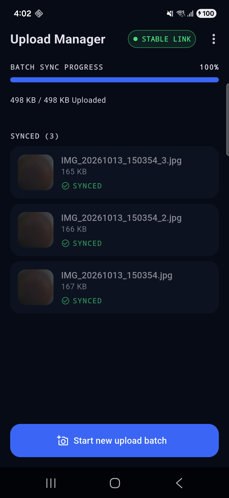
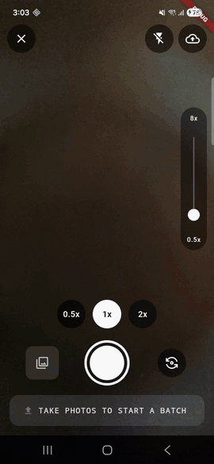

# Pinpoint Capture (Task 2)

Custom camera with pinch / slider / preset zoom and tap-to-focus, plus an offline-first upload queue that retries
by itself through a background worker. Flutter, Cubit (`flutter_bloc`). Back to the
[repository overview](../README.md). Download APK: [pinpoint-capture-v1.0.apk](../download-apk/pinpoint-capture-v1.0.apk).

## Requirements coverage
| Requirement | Where it lives |
|---|---|
| `CameraPreviewScreen` with pinch zoom, slider and rounded presets | `presentation/camera/`, `CameraCubit`, `ZoomCapabilities` |
| 0.5x shown only when the device has an ultrawide lens | Lens detection in the camera adapter, mapped to `ZoomCapabilities` |
| Tap-to-focus with a visible indicator | `CameraCubit`, focus indicator widget |
| Capture multiple batches, "Pending Uploads" list | `EnqueueBatchUseCase`, `UploadManagerScreen`, `UploadQueueCubit` |
| Queue persists, images stay on failure | `SqfliteUploadQueueRepository`, `ProcessUploadQueueUseCase` |
| Background worker retries on connectivity without user action | `workers/sync_worker.dart`, `SyncScheduler`, `SyncCoordinator` |
| Mock API with success / failure | `MockUploadApi` behind `UploadApi`, `MockModeCubit` |

## Technology stack
| | |
|---|---|
| Language | Dart `^3.13.1`, Flutter 3.x |
| Platform | Android (`compileSdk` 37, Flutter default `minSdk`); iOS project present but not the target |
| Architecture | Layered: `presentation` -> `domain` -> `data`, one immutable state per Cubit |
| Patterns | Repository, Adapter/Wrapper, Use case, Observer, Strategy, Constructor injection |
| State | `flutter_bloc` 9.1.1 (Cubit), `equatable` 3.0.0 |
| DI | Manual constructor injection in `app/di.dart`, no service locator |
| Camera | `camera` 0.12.1 behind `CameraService` |
| Permissions | `permission_handler` 13.0.2 behind `CameraPermissionService` |
| Storage | `sqflite` 2.4.4 (upload queue), `shared_preferences` 2.5.6 (pause flag, mock mode), `path_provider` 2.1.6 (image files) |
| Connectivity | `connectivity_plus` 7.3.2 behind `ConnectivityService` |
| Background | `workmanager` 0.10.10 behind `SyncScheduler` |
| Tests | `flutter_test`, `bloc_test` 10.0.0, `mocktail` 1.0.5, `sqflite_common_ffi` 2.4.3, `integration_test`, `flutter_lints` 6.0.0 |

Why these choices: Cubit keeps state transitions small and testable without the event boilerplate of Bloc; sqflite is
enough for one queue table, so Drift's code generation was not needed; `workmanager` survives process death, which the
retry-without-user-action rule needs; every plugin sits behind a domain interface so tests use fakes.

## Project structure
```
task-2-flutter-camera-sync/
├── pubspec.yaml, analysis_options.yaml
├── screenshots/                    images used by this README
├── lib/
│   ├── main.dart                   entry point
│   ├── app/                        app.dart (MaterialApp), di.dart (constructor injection)
│   ├── core/                       constants, strings, theme, clock, formatters
│   ├── presentation/
│   │   ├── camera/                 CameraPreviewScreen, CameraCubit, CameraState,
│   │   │   └── widgets/            zoom slider and presets, focus indicator, capture bar
│   │   ├── upload_manager/         UploadManagerScreen, UploadQueueCubit, UploadQueueState,
│   │   │   └── widgets/            upload tile, connection chip, sync progress header
│   │   └── settings/               MockModeCubit and the mock upload result sheet
│   ├── domain/
│   │   ├── entities/               CaptureBatch, PendingUpload, UploadStatus, ZoomCapabilities
│   │   ├── repositories/           UploadQueueRepository interface
│   │   ├── services/               CameraService, UploadApi, SyncScheduler, ImageStore, ...
│   │   └── usecases/               EnqueueBatch, ProcessUploadQueue, SyncCoordinator, ClearSynced
│   ├── data/
│   │   ├── db/                     sqflite database setup
│   │   ├── files/                  local image storage
│   │   ├── repositories/           SqfliteUploadQueueRepository
│   │   └── services/               camera, connectivity, permission, workmanager adapters,
│   │                               MockUploadApi, shared_preferences stores
│   └── workers/sync_worker.dart    workmanager background entry point
├── test/                           unit and widget tests: core, data, domain, presentation
└── integration_test/               capture -> upload fails -> queue persists -> upload succeeds
```

| Folder | Layer | Responsibility |
|---|---|---|
| `presentation/` | presentation | Screens and Cubits; widgets render one immutable state. |
| `domain/` | domain | Entities, use cases and service interfaces. No Flutter or plugin imports. |
| `data/` | data | Implements the domain interfaces with plugins, sqflite and `MockUploadApi`. |
| `workers/` | background | Runs the same upload use case as the UI, in a separate isolate. |
| `app/` | wiring | Builds the dependency graph by constructor injection. |

## Approach
Layered `presentation` -> `domain` -> `data` with **Cubit** (flutter_bloc). Plugins sit behind interfaces defined in
domain, and everything is wired by constructor injection in `app/di.dart`. Each Cubit emits one immutable state
object and the widgets only render it.

```
presentation/camera          CameraPreviewScreen, CameraCubit, zoom slider/presets, focus indicator
presentation/upload_manager  UploadManagerScreen, UploadQueueCubit
presentation/settings        MockModeCubit (mock upload result sheet)
domain                       entities, service interfaces, use cases
data                         sqflite queue, camera plugin, connectivity_plus, workmanager, MockUploadApi
workers                      sync_worker.dart: workmanager entry point
```

Main classes:
- `CameraCubit`: permission, camera start/stop, pinch/slider/preset zoom, tap-to-focus, capture and batch enqueue.
- `UploadQueueCubit`: pending list, progress, pause/resume, retry now, clear synced.
- `MockModeCubit`: success / failure / slow toggle for the mock API.

Patterns, used where they earn their place:
- **Repository**: `UploadQueueRepository` interface in domain, `SqfliteUploadQueueRepository` in data.
- **Adapter/Wrapper**: `camera`, `connectivity_plus`, `permission_handler`, `workmanager` and file storage sit behind
  `CameraService`, `ConnectivityService`, `CameraPermissionService`, `SyncScheduler` and `ImageStore`, so tests use fakes.
- **Use case**: `EnqueueBatchUseCase`, `ProcessUploadQueueUseCase`, `SyncCoordinator`.
- **Observer**: Cubit streams for UI state; a queue-change bus tells the open screen what the background worker did.
- **Strategy**: `UploadApi` has `MockUploadApi` today; a real API is a new implementation, with no consumer changes.

How the sync engine works:
- Captured images are copied to app storage and queued in sqflite (`waiting`, `uploading`, `retrying`, `synced`).
  The queue survives app restarts and process death.
- A `workmanager` one-off task runs only with a network connection and uses exponential backoff
  (10 s start). The worker uploads oldest first and stops at the first failure.
- An upload that fails or takes longer than 15 s (low bandwidth) stays in the queue as `retrying`, with the reason.
- `SyncCoordinator` schedules a run when the app starts with queued images and when connectivity returns, so
  retries need no user action. **Retry now** and **Pause all** exist for manual control.
- No real API was provided. `MockUploadApi` returns hard-coded success or failure. Change it at runtime from the
  Upload Manager menu (**Mock upload result**: Success, Failure, Slow).

## Testing
`flutter_test`, `bloc_test`, `mocktail`, `sqflite_common_ffi` in `test/`: Cubits, queue repository, retry and backoff, widgets.
End to end: `integration_test/capture_to_sync_test.dart`: capture, upload fails, queue persists, upload succeeds.
Tests are deterministic: clock, connectivity and the upload API are injected fakes.

```bash
flutter analyze
flutter test
flutter test integration_test            # emulator or device
```

## How to run
```bash
cd pinpoint-attendance-task/task-2-flutter-camera-sync
flutter pub get
flutter run
```
Requires Flutter 3.x (Dart `^3.13`). Use a **physical device** for camera zoom, tap-to-focus and background sync.
To see a retry: open the Upload Manager (upload icon, top bar) -> menu -> **Mock upload result** -> Failure, capture
a batch, then switch to Success. The queue uploads by itself, or tap **Retry now**.

Release build:
```bash
flutter build apk --release   # build/app/outputs/flutter-apk/app-release.apk
```

### Reviewer guide: trigger each state
| To see | Do this |
|---|---|
| Upload failure and automatic retry | Upload Manager -> menu -> **Mock upload result** -> Failure, capture and upload a batch, then switch to Success. Do not tap anything else: the queue uploads by itself. |
| Low bandwidth | Mock upload result -> **Slow connection**. The upload times out after 15 s and stays queued as `retrying`. |
| Offline | Enable airplane mode, capture a batch. It waits in the queue, then uploads when the network returns. |

## Screenshots
| Camera preview | Batch ready | Upload failed, retrying | Synced |
|---|---|---|---|
|  |  |  |  |


